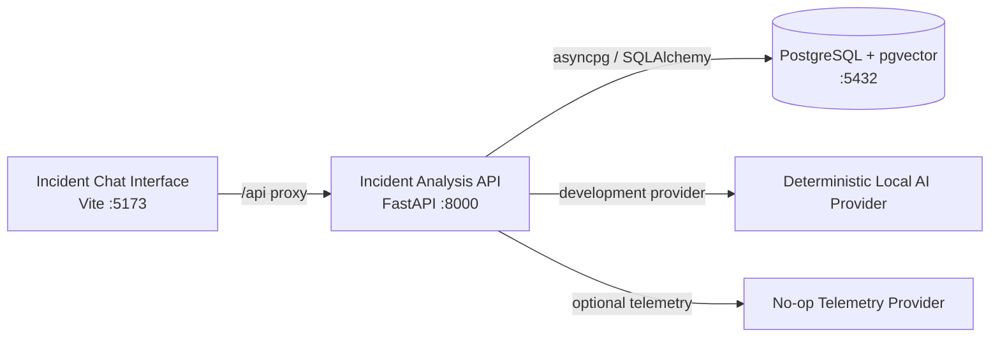

# Azure Debug Plan

> This plan is the source of truth for generating the
> VS Code debug setup in this workspace.
>
> **Status:** Implemented
> **Execution Mode:** Auto
> **Created:** 2026-10-13T12:16:55+01:00
> **Last Updated:** 2026-10-13T12:38:11+01:00
>
> <!-- Guided Mode (default) - hand-holds the user through review and approval before generating. -->
> <!-- Auto Mode (aka YOLO mode) - skips approval gates and runs generation unattended. -->

---

## Prerequisites

| Tool / Extension | Category | Service(s) | Installed | Version |
|------------------|----------|------------|-----------|---------|
| Python | Runtime | Incident Analysis API | ✅ | 3.12.10 |
| pip | Package manager | Incident Analysis API | ✅ | 25.0.1 |
| Node.js | Runtime | Incident Chat Interface | ✅ | 24.20.0 |
| npm | Package manager | Incident Chat Interface | ✅ | 11.19.0 |
| Docker | Container runtime | Incident Analysis API | ✅ | 29.8.2 |
| Docker Compose | Compose provider | Incident Analysis API | ✅ | 5.6.0 |
| Microsoft Edge | Browser | Incident Chat Interface | ✅ | 155.0.4283.45 |

> **Action required:** No prerequisite is currently unconfirmed. Recheck tool versions if the local toolchain changes before generation.

---

## Debug Configurations

Each checked row below produces a VS Code debug configuration in `.vscode/launch.json`.

| Generate | Debug Config Name | Service Label | Service Root | Project Type | Runtime | Version | Azure Dependencies |
|----------|--------------------|---------------|--------------|--------------|---------|---------|--------------------|
| [x] | Incident Analysis API (debug) | Incident Analysis API | ./services/incident-api | app-service | python | >=3.11 | Azure Database for PostgreSQL, Azure OpenAI, Application Insights |
| [x] | Incident Chat Interface (debug) | Incident Chat Interface | ./services/incident-web | frontend-spa | node-js | 24.x | - |
| [x] | Debug All Services | Debug All Services |  | *Compound Config* |  |  |  |

Project Type Descriptions

| Project Type | Description |
|-------------|-------------|
| app-service | HTTP server application implemented with FastAPI and Uvicorn |
| frontend-spa | Single-page application served by the Vite development server and debugged in Edge |

> **Proxy detected:** Incident Chat Interface proxies `/api` requests to Incident Analysis API at `http://localhost:8000` via `vite.config.js`. The compound configuration starts the API before the frontend.

---

## Orchestrator

| Orchestrator | Container Runtime | Compose Command | Description |
|-------------|-------------------|-----------------|-------------|
| Docker Compose | Docker | `docker compose` | Uses the existing `compose.yaml` to run the PostgreSQL/pgvector dependency for local development |

---

## Emulators

| Dependent Service | Emulator | Purpose |
|-------------------|----------|---------|
| Azure Database for PostgreSQL | PostgreSQL/pgvector Container | Provides PostgreSQL 16 with pgvector on port 5432 using the existing Compose service |
| Azure OpenAI | Deterministic Local AI Provider | Provides in-process, network-free diagnosis behavior when `ENVIRONMENT=Development` |
| Application Insights | No-op Telemetry Provider | Keeps local telemetry optional and network-free when no connection string is configured |

---

## Architecture Diagram

During local debugging, the Vite interface proxies API requests to FastAPI, while the API uses the PostgreSQL container and its in-process development providers.

---

## Migrations

When selected, the generation phase creates automated VS Code tasks that apply migrations after PostgreSQL becomes healthy and before the API starts.

| Generate | Service | Migration Tool |
|----------|---------|----------------|
| [x] | Incident Analysis API | Alembic (`alembic upgrade head`, run from `./services/incident-api`) |

---

## API Test Collections

When selected, the generation phase produces lightweight, runnable API smoke tests for the launched local stack.

| Generate | Service | Description |
|----------|---------|-------------|
| [x] | Incident Analysis API | 

HTTP Endpoints (6)
 GET /api/health POST /api/auth/register POST /api/auth/login POST /api/auth/logout GET /api/auth/me POST /api/incidents/analyze  OpenAPI UI: GET /api/docs OpenAPI schema: GET /api/openapi.json  
 |

---

## Convenience Scripts

| Generate | Script | Registered In | Description |
|----------|--------|---------------|-------------|
| [x] | emulators:start | ./.vscode/tasks.json | Start the existing PostgreSQL service in the background and wait for health |
| [x] | emulators:stop | ./.vscode/tasks.json | Stop the local Compose services while preserving database data |
| [x] | emulators:clean | ./.vscode/tasks.json | Stop the local Compose services and remove their persisted volumes |
| [x] | db:migrate | ./.vscode/tasks.json | Apply pending Alembic migrations to the local PostgreSQL database |

---

## Debug Configuration Checklist

Debug Configuration Checklist:
✅ Incident Analysis API (debug) — Uvicorn and debugpy became ready on ports 8000 and 5678; `GET /api/health` returned HTTP 200; all six API smoke-test scripts passed. External Azure AI and telemetry access was not required because Development uses the deterministic local AI provider and no-op telemetry provider.
✅ Incident Chat Interface (debug) — Vite reported its local URL on port 5173 and returned HTTP 200.
✅ Debug All Services — the sequenced compound started one API instance and one Vite instance; both reached their ready signals and returned HTTP 200.
✅ Final teardown — validation processes and Docker Compose services stopped; ports 5173, 5678, 8000, and 5432 were confirmed free while the PostgreSQL data volume was preserved.
